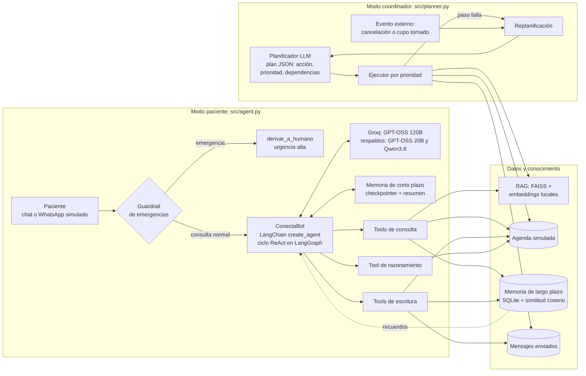

# SaludConecta-IA — Agente ConectaBot para gestión autónoma de citas

Proyecto de ISY0101 Ingeniería de Soluciones con Inteligencia Artificial (DuocUC, 2026-2).
Integrantes: Diego Hernández y Benjamín Heresmann. Continúa el repositorio de la EP1 (github.com/Diego-ai-he/SaludConecta-IA).

La Red de Salud SaludConecta (5 sedes, más de 120 especialistas, unas 15.000 citas al mes) pierde el 28 % de sus horas por inasistencias no avisadas y su call center gasta más del 40 % de la jornada en confirmaciones manuales. En la EP1 construimos un RAG que responde dudas de preparación. En la EP2 lo convertimos en un **agente funcional** que consulta, escribe y razona sobre la agenda: confirma, reagenda, cancela, recupera cupos para la lista de espera y planifica la gestión diaria por prioridades.

| Meta del caso (EP1) | Cómo aporta el agente |
|---|---|
| No-shows de 28 % a menos de 15 % | Riesgo de inasistencia por cita y recordatorios priorizados |
| Recuperar más del 60 % de los cupos cancelados con más de 24 h | Cancelación que libera el cupo y lo reasigna a la lista de espera priorizada |
| 80 % de consultas resueltas sin humanos | RAG semántico sobre protocolos y herramientas de agenda |
| Recall mayor a 80 % en riesgo de no-show | Puntaje de riesgo por reglas (simplificación del clasificador propuesto) |

## Arquitectura y orquestación



El sistema tiene dos modos:

1. **Modo paciente** (`src/agent.py`): conversación con un paciente autenticado. Antes de llamar al LLM se aplica un guardrail determinista de emergencias y se recuperan los recuerdos relevantes del paciente. Luego el agente ReAct decide qué herramientas usar, en qué orden y qué hacer si una falla.
2. **Modo coordinador** (`src/planner.py`): gestión de las citas de las próximas 48 h. El LLM arma un plan con prioridades; un ejecutor lo cumple en orden y replanifica cuando cambia el entorno.

### Componentes

| Componente | Tecnología | Archivo |
|---|---|---|
| Framework de agentes | LangChain 1.4 `create_agent` (grafo de LangGraph) con middleware | `src/agent.py` |
| LLM | Groq en cascada: `openai/gpt-oss-120b` (principal), `openai/gpt-oss-20b` y `qwen/qwen3.8-27b` con `ModelFallbackMiddleware`; sin reintentos ante un límite de uso (429), pasa al siguiente modelo | `src/config.py` |
| RAG | `PyPDFDirectoryLoader` + `TextLoader`, chunks 350/50, FAISS, k=3. Embeddings locales con FastEmbed (`paraphrase-multilingual-MiniLM-L12-v2`, 384 dim) por defecto; `gemini-embedding-001` (EP1) opcional con `EMBEDDINGS_PROVIDER=gemini` | `src/rag_engine.py` |
| Memoria de corto plazo | `InMemorySaver` (un `thread_id` por sesión) + `SummarizationMiddleware` (sobre 14 mensajes resume y conserva 6) | `src/agent.py` |
| Memoria de largo plazo | SQLite con embedding por recuerdo y recuperación por similitud coseno; respaldo por palabras si no hay API | `src/memoria.py` |
| Planificación | Plan-and-Execute con salida estructurada (Pydantic), prioridades 1-5, dependencias y replanificación | `src/planner.py` |
| Agenda | JSON simulado y anonimizado (reemplaza al HIS/ERP), reglas de negocio | `src/agenda.py`, `data/agenda_seed.json` |
| Registro de decisiones | Consola con colores + `data/runtime/decisiones.jsonl` | `src/registro.py` |

### Herramientas del agente

| Tipo | Herramienta | Qué hace |
|---|---|---|
| Consulta | `buscar_protocolos` | RAG semántico sobre los protocolos; devuelve fragmentos, fuente y distancia |
| Consulta | `consultar_citas_paciente` | Citas vigentes del paciente |
| Consulta | `buscar_cupos_disponibles` | Cupos libres por especialidad, sede y franja (mañana o tarde) |
| Consulta | `recordar_paciente` | Recuerdos del paciente desde la memoria de largo plazo |
| Escritura | `reagendar_cita` | Mueve la cita; si el cupo ya no está, devuelve error para que el agente elija otro |
| Escritura | `cancelar_cita` | Cancela, libera el cupo e informa si fue con 24 h (sin costo) |
| Escritura | `reasignar_cupo_liberado` | Asigna el cupo al primero de la lista de espera y le avisa |
| Escritura | `enviar_mensaje_paciente` | Mensaje de WhatsApp simulado (`data/runtime/mensajes_enviados.jsonl`) |
| Escritura | `guardar_preferencia_paciente` | Guarda una preferencia en la memoria de largo plazo |
| Escritura | `derivar_a_humano` | Deriva a recepción o a un profesional de salud |
| Razonamiento | `evaluar_riesgo_inasistencia` | Puntaje 0-1, nivel y factores del riesgo de no-show |

Puntaje de riesgo = 0,50 × tasa histórica de inasistencia + 0,20 si reservó con más de 14 días + 0,15 si tiene entre 18 y 30 años + 0,15 si no ha confirmado. Alto ≥ 0,5; medio ≥ 0,3.

### Esquema de planificación por prioridades

| Prioridad | Acción | Cuándo |
|---|---|---|
| 1 | `reasignar_cupo` | Hay un cupo liberado: la hora se pierde si no se reasigna pronto |
| 2 | `recordatorio_reforzado` | Cita sin confirmar con riesgo alto |
| 2 | `escalar_call_center` | Riesgo alto y 3 o más inasistencias previas; va después del recordatorio reforzado |
| 3 | `enviar_preparacion` | Exámenes con preparación (sangre, ecografía); el texto sale del RAG |
| 4 | `recordatorio_estandar` | Riesgo medio |
| 5 | `recordatorio_estandar` | Riesgo bajo |

Lista de espera: primero la urgencia clínica, después la sede preferida y después los días en espera.

## Instalación

Requisitos: Python 3.12 o superior, Git y una clave de Groq. La clave de Google AI Studio solo se necesita si usas `EMBEDDINGS_PROVIDER=gemini`.

```bash
git clone https://github.com/BenjaminHeresmann/SaludConecta-IA.git
cd SaludConecta-IA
python -m venv venv
.\venv\Scripts\activate
pip install -r requirements.txt
copy .env.example .env
```

Edita `.env` con tus claves. `.env` está en `.gitignore`: nunca lo subas al repositorio.

## Ejecución

Todos los comandos se ejecutan desde la raíz del repositorio.

```bash
python -m src.rag_engine          # 1. construye el índice FAISS (la primera vez descarga el modelo de embeddings, unos 240 MB, en <unidad>:\modelos-ia)
python -m src.demo --pausa        # 2. demo de 6 escenarios, con pausa entre ellos
python -m src.agent --paciente P001 --reset   # chat libre con un paciente
python -m src.demo --sin-llm      # modo coordinador con el planificador por reglas (sin API)
python -m src.coordinador         # coordinador sobre la agenda actual (ve lo que hicieron los pacientes en el chat)
# En el chat libre (src.agent), cada cancelación o reagendamiento se avisa al Coordinador, que planifica la cita afectada.
python -m src.coordinador --reiniciar   # deja la agenda como al inicio
```

### Escenarios de la demo

| N.º | Escenario | Condición del entorno | Decisión esperada del agente |
|---|---|---|---|
| 1 | Preparación de examen | Pregunta con otras palabras ("¿puedo tomar café?") | Busca en el RAG y responde con el protocolo de ayuno |
| 2 | Cancelación | Hay lista de espera de dermatología | Cancela, informa si fue sin costo y reasigna el cupo |
| 3 | Reagendar a la tarde | El primer cupo de la tarde lo toma otro canal | Recibe el error y elige el siguiente cupo compatible; guarda la preferencia |
| 4 | Emergencia | Dolor en el pecho | Guardrail: deriva a urgencias sin tocar la agenda |
| 5 | Memoria entre sesiones | Se reinicia el agente | Recupera "prefiere la tarde" desde SQLite y busca en esa franja |
| 6 | Coordinador | Una cancelación llega mientras corre el plan | Replanifica y reasigna el cupo liberado con prioridad 1 |

## Pruebas

```bash
python -m pytest -v
```

25 pruebas sin conexión (no llaman a Groq ni a Gemini): guardrails, herramientas, riesgo, lista de espera, cupo tomado, cancelación con reasignación, plan por prioridades, corrección del plan del LLM, replanificación, memoria persistente y el ciclo completo del agente con un LLM simulado (recupera el error de cupo tomado y usa la memoria). Resultado: `docs/evidencia_tests_ep2.txt`. Registro de una demo en vivo con Groq: `docs/evidencia_demo_ep2.txt`. Cada ejecución de la demo deja su registro en `data/runtime/decisiones.jsonl`.

## Estructura

```
SaludConecta-IA/
├── data/
│   ├── agenda_seed.json        # agenda simulada y anonimizada
│   ├── docs_rag/               # protocolos (PDF de la EP1 + protocolos ampliados simulados)
│   └── runtime/                # estado generado al ejecutar (no se versiona)
├── docs/                       # diagramas y evidencia de pruebas
├── faiss_index/                # índice vectorial
├── src/
│   ├── agent.py                # ConectaBot: create_agent, middleware, guardrail
│   ├── tools.py                # 11 herramientas
│   ├── memoria.py              # memoria de largo plazo
│   ├── planner.py              # planificador por prioridades y replanificación
│   ├── agenda.py               # sistema de agenda simulado
│   ├── rag_engine.py           # ingesta y búsqueda semántica
│   ├── demo.py                 # escenarios de la presentación
│   ├── registro.py             # registro de decisiones
│   └── config.py               # rutas, LLM y embeddings
├── tests/                      # pytest
├── .env.example
└── requirements.txt
```

## Limitaciones y simplificaciones

- La agenda, los pacientes y la lista de espera son simulados y anonimizados (Ley 19.628). No hay conexión a un HIS real ni a WhatsApp Business: los mensajes quedan en un archivo.
- El riesgo de inasistencia usa reglas con pesos fijos, no el clasificador entrenado que propusimos en la EP1. No tiene métricas de recall.
- `protocolos_ampliados.md` es un documento simulado para el proyecto; no reemplaza indicaciones médicas.
- La memoria de corto plazo vive en RAM: al reiniciar el agente solo queda la de largo plazo.
- Groq gratis tiene cuotas por minuto y por modelo (`qwen/qwen3.8-27b`: 1.000 tokens de salida por minuto; `gpt-oss-120b`: 8.000 tokens por minuto). Por eso hay una cascada de modelos. En la demo en vivo la latencia promedio con LLM fue 8,3 s (`docs/evidencia_demo_ep2.txt`).
- En la EP1 los embeddings eran de Gemini. En la EP2 la API de Gemini devolvió `403 PERMISSION_DENIED` para el proyecto de la clave, por eso el valor por defecto es un modelo local; el índice de Gemini sigue disponible como opción.
- FAISS (C++) no abre rutas con tildes en Windows: el índice se guarda como bytes desde Python (`faiss_index_local/indice_ep2.bin`).

## Uso de IA en el desarrollo

Usamos Claude (Anthropic) como asistente de programación y de documentación. Revisamos y probamos todo el código generado.
